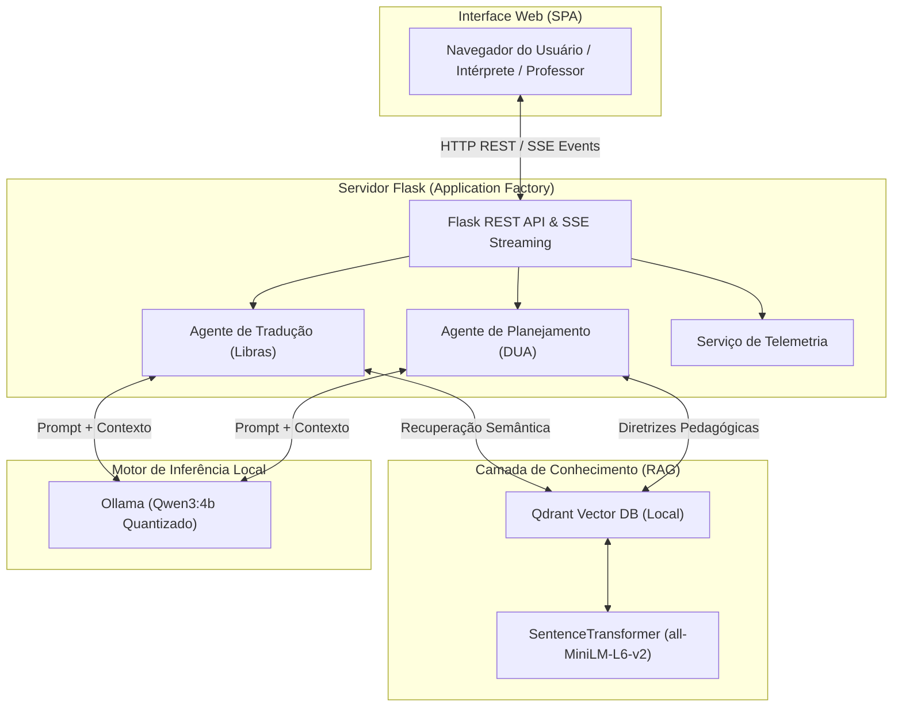

# IncluSign AI 🤟🤖

<div align="center">

**Plataforma de Agentes de Inteligência Artificial para Inclusão Educacional e Tradução em Libras**

[](https://github.com/RowanFalcao/inclusign-ai/actions)
[](https://www.python.org/)
[](https://opensource.org/licenses/MIT)
[](https://github.com/astral-sh/ruff)
[](https://mypy-lang.org/)
[](https://ollama.ai)

*Pesquisa desenvolvida no âmbito do Programa Institucional Voluntário de Iniciação Científica (PIVIC)*  
*Universidade de Rio Verde (UniRV) — Apresentação oficial no CICURV 2026*

</div>

---

## 📌 Visão Geral

A inclusão de estudantes surdos e neurodivergentes no ensino técnico e superior enfrenta barreiras críticas na **tradução de jargões científicos de alta complexidade para Libras** e na **elaboração do Desenho Universal para a Aprendizagem (DUA)** por docentes sobrecarregados.

O **IncluSign AI** é uma plataforma prototípica baseada em múltiplos agentes de IA que opera **100% offline**, garantindo custo zero de tokens e conformidade com a privacidade de dados institucionais (LGPD).

### Módulos Principais
1. **Módulo de Tradução Contextual para Libras:** Fornece apoios visuoespaciais, descrições glosadas e mediação semiótica precisa para jargões técnicos em **Computação**, **Medicina** e **Agronomia**.
2. **Módulo de Planejamento Pedagógico Adaptado:** Gera planos de aula estruturados e alinhados às diretrizes do DUA para cenários de **TEA** (Níveis de suporte 1 e 2) e **TDAH** (apresentações desatenta, hiperativa e combinada).

---

## 🏗️ Arquitetura do Sistema

A plataforma foi desenhada seguindo os princípios de baixo acoplamento e alta coesão, utilizando o padrão **Adapter** para comunicação com o LLM e **Retrieval-Augmented Generation (RAG)** com o banco vetorial **Qdrant**.



---

## ⚙️ Pré-requisitos do Sistema

Antes de iniciar, certifique-se de que sua máquina possui as seguintes ferramentas instaladas:

1. **Python 3.11 ou 3.12**
   * Verifique com: `python --version`
2. **Git**
   * Verifique com: `git --version`
3. **Ollama (Motor de Inferência)**
   * O Ollama é um executável de sistema operacional e **não** é instalado pelo `pip`.
   * **Instalação via terminal (comandos oficiais):**
     * **Windows (PowerShell):**
       ```powershell
       irm https://ollama.com/install.ps1 | iex
       ```
     * **Linux:**
       ```bash
       curl -fsSL https://ollama.com/install.sh | sh
       ```
     * **macOS:**
       ```bash
       curl -fsSL https://ollama.com/install.sh | sh
       ```
   * **Download manual (instalador gráfico):** [ollama.com/download](https://ollama.com/download)
4. **Memória RAM:** Mínimo recomendado de **8 GB** para comportar o modelo de linguagem (`qwen3:4b`) e o modelo vetorial em memória simultaneamente.

> **Nota sobre o `pip install -r requirements.txt`:**  
> O comando `pip` instala estritamente as bibliotecas Python da aplicação (`flask`, `qdrant-client`, `sentence-transformers`, `pymupdf`, etc.). O executável do Ollama e os pesos dos modelos neurais são gerenciados de forma independente pelo próprio Ollama.

---

## 🚀 Instalação e Execução Passo a Passo

Projetada para execução local em Windows, Linux e macOS.

O sistema pode ser configurado e executado integralmente dentro dos terminais da sua IDE (VS Code, Cursor, Antigravity, PyCharm) ou por terminais externos do sistema operacional (PowerShell, Prompt de Comando, Bash).

O sistema é composto por **dois serviços concorrentes**:
* **Serviço 1 (Inferência IA):** Ollama escutando em `http://127.0.0.1:11434`.
* **Serviço 2 (Aplicação Web):** Servidor Flask escutando em `http://127.0.0.1:5000`.

---

### Passo 1: Clonar o Repositório e Configurar o Ambiente Python

No terminal da sua IDE ou sistema operacional:

```bash
git clone https://github.com/RowanFalcao/inclusign-ai.git
cd inclusign-ai
```

Crie o ambiente virtual:
```bash
python -m venv .venv
```

Ative o ambiente virtual:
* **No Windows (PowerShell):**
  ```powershell
  .\.venv\Scripts\Activate.ps1
  ```
  *(Caso o PowerShell bloqueie a execução de scripts por política do Windows, execute antes: `Set-ExecutionPolicy -Scope Process -ExecutionPolicy Bypass`)*
* **No Windows (Prompt de Comando - CMD):**
  ```cmd
  .\.venv\Scripts\activate.bat
  ```
* **No Linux / macOS:**
  ```bash
  source .venv/bin/activate
  ```

Instale as dependências da aplicação:
```bash
pip install -r requirements.txt
```

---

### Passo 2: Iniciar o Motor de Inferência e Baixar o Modelo

O backend da aplicação precisa que o Ollama esteja respondendo na porta local `11434`.

#### 1. Iniciar o Serviço do Ollama
Escolha uma das opções:
* **Opção A (Padrão no Windows):** Abra o aplicativo **Ollama** instalado. Ele iniciará automaticamente em segundo plano e ficará visível na bandeja do sistema (ao lado do relógio do Windows).
* **Opção B (Via Terminal):** Em uma aba de terminal dedicada, execute:
  ```bash
  ollama serve
  ```
  *(Deixe esse terminal aberto para manter o serviço ativo).*

#### 2. Baixar o Modelo Qwen3:4b
Em uma aba de terminal com o serviço do Ollama ativo, execute o comando de download:
```bash
ollama pull qwen3:4b
```

> **Atenção:** Utilizamos `ollama pull qwen3:4b` para fazer o download dos parâmetros sem bloquear o terminal. O comando `ollama run` inicia uma sessão interativa de chat no terminal e deve ser evitado durante a inicialização do servidor.

---

### Passo 3: Iniciar a Aplicação Web

Em um terminal com o ambiente virtual ativado (`.venv`) e com o Ollama em execução:

```bash
python app.py
```

#### Comportamento Esperado na Inicialização:
1. **O terminal permanecerá ocupado:** O Flask é um servidor web contínuo e mantém o processo em execução enquanto a aplicação estiver ativa. Não encerre a janela.
2. **Tempo de inicialização (RAG & Embeddings):** Nos primeiros 5 a 15 segundos, o terminal pode parecer silencioso enquanto o modelo de embeddings (`all-MiniLM-L6-v2`) e o banco vetorial local (`Qdrant`) são carregados em memória.
3. **Servidor pronto:** Quando o terminal exibir a mensagem:
   ```text
   ============================================================
     IncluSign AI — Plataforma Pronta (CICURV 2026)
     URL: http://127.0.0.1:5000
   ============================================================
   ```
4. **Acesso:** Abra seu navegador web e acesse:
   **`http://localhost:5000`** ou **`http://127.0.0.1:5000`**

---

## 🐳 Opção Alternativa: Execução via Docker Compose

Caso prefira isolar a aplicação em contêiner Docker:

```bash
docker compose up --build
```

O contêiner subirá a aplicação na porta `5000` e se comunicará com o Ollama do host em `host.docker.internal:11434`.  
Certifique-se de que o Ollama já está em execução no computador host com o modelo baixado (`ollama pull qwen3:4b`).

---

## 🧪 Estratégia de Testes Automatizados

O projeto conta com suíte de testes com `pytest` cobrindo regras de negócio, contratos da API e cenários empíricos pedagógicos validados na pesquisa. Os testes utilizam *mocks* determinísticos, podendo ser executados sem necessidade de GPU ou Ollama ativo.

#### Execução rápida dos testes:
```bash
pytest tests -v
```

#### Para análise de cobertura e qualidade de código:
Instale as dependências de desenvolvimento (inclui `pytest-cov`, `ruff` e `mypy`):
```bash
pip install -r requirements-dev.txt
```

Gerar relatório de cobertura:
```bash
pytest --cov=agents --cov=services --cov=app tests/
```

Checagem estática de formatação e tipagem:
```bash
ruff check .
mypy app.py config.py agents/ services/
```

---

## 👥 Autoria e Afiliação Científica

* **Rowan Falcão Rodrigues Lopes da Silva** — Engenharia de Software, UniRV
* **Wayrone Klaiton Luiz Silva** — Prof. Me. e Coorientador, UniRV
* **Edina Ferreira Martins Falcão Lopes** — Intérprete de Libras, UniRV
* **Flávio Silva de Oliveira** — Intérprete de Libras, UniRV
* **Profa. Dra. Fabiana Girotto Ribeiro** — Orientadora, UniRV (`girotto@unirv.edu.br`)

**Instituição:** Universidade de Rio Verde (UniRV)  
**Modalidade:** Programa Institucional Voluntário de Iniciação Científica (PIVIC)  
**Congresso:** CICURV 2026 (05 de Novembro de 2026)

---

## ⚖️ Licença

Este projeto é distribuído sob a licença [MIT](LICENSE).
