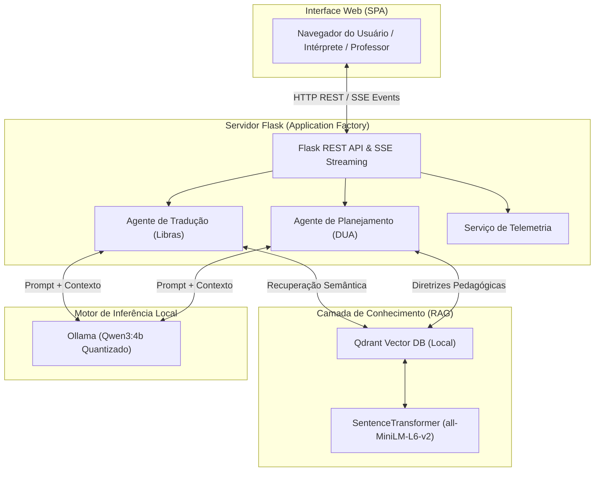

# IncluSign AI 🤟🤖

<div align="center">

**Plataforma de Agentes de Inteligência Artificial para Inclusão Educacional e Tradução em Libras**

[](https://github.com/RowanFalcao/inclusign-ai/actions)
[](https://www.python.org/)
[](https://opensource.org/licenses/MIT)
[](https://github.com/astral-sh/ruff)
[](https://mypy-lang.org/)
[](https://ollama.ai)

*Pesquisa desenvolvida no âmbito do Programa Institucional Voluntário de Iniciação Científica (PIVIC)*  
*Universidade de Rio Verde (UniRV) — Apresentação oficial no CICURV 2026*

</div>

---

## 📌 Visão Geral

A inclusão de estudantes surdos e neurodivergentes no ensino técnico e superior enfrenta barreiras críticas na **tradução de jargões científicos de alta complexidade para Libras** e na **elaboração do Desenho Universal para a Aprendizagem (DUA)** por docentes sobrecarregados.

O **IncluSign AI** é uma plataforma prototípica baseada em múltiplos agentes de IA que opera **100% offline**, garantindo custo zero de tokens e conformidade com a privacidade de dados institucionais (LGPD).

### Módulos Principais
1. **Módulo de Tradução Contextual para Libras:** Fornece apoios visuoespaciais, descrições glosadas e mediação semiótica precisa para jargões técnicos em **Computação**, **Medicina** e **Agronomia**.
2. **Módulo de Planejamento Pedagógico Adaptado:** Gera planos de aula estruturados e alinhados às diretrizes do DUA para cenários de **TEA** (Níveis de suporte 1 e 2) e **TDAH** (apresentações desatenta, hiperativa e combinada).

---

## 🏗️ Arquitetura do Sistema

A plataforma foi desenhada seguindo os princípios de baixo acoplamento e alta coesão, utilizando o padrão **Adapter** para comunicação com o LLM e **Retrieval-Augmented Generation (RAG)** com o banco vetorial **Qdrant**.



---

## 🚀 Início Rápido (Quickstart)

A plataforma é 100% reprodutível em **Windows**, **Linux** e **macOS**.

### Opção 1: Execução Local em 3 Comandos

#### 1. Instalar dependências e preparar o ambiente
```bash
git clone https://github.com/RowanFalcao/inclusign-ai.git
cd inclusign-ai
python -m venv .venv
source .venv/bin/activate  # No Windows: .\.venv\Scripts\Activate.ps1
pip install -r requirements.txt
```

#### 2. Iniciar o motor local de inferência (Ollama)
```bash
ollama run qwen3:4b
```

#### 3. Iniciar a aplicação
```bash
python app.py
```
Acesse no seu navegador: **`http://localhost:5000`**

---

### Opção 2: Execução via Docker Compose

```bash
docker compose up --build
```
O contêiner subirá automaticamente com healthchecks integrados e usuário não-privilegiado de segurança (`appuser`).

---

## 🧪 Estratégia de Testes Automatizados

O projeto conta com uma suíte de testes automatizados com `pytest` cobrindo regras de negócio, rotas da API e os casos empíricos validados na pesquisa.

Para rodar os testes:
```bash
pytest tests -v
```

Para verificar o relatório de cobertura de código:
```bash
pytest --cov=agents --cov=services --cov=app tests/
```

---

## 👥 Autoria e Afiliação Científica

* **Rowan Falcão Rodrigues Lopes da Silva** — Engenharia de Software, UniRV
* **Wayrone Klaiton Luiz Silva** — Prof. Me. e Coorientador, UniRV
* **Edina Ferreira Martins Falcão Lopes** — Intérprete de Libras, UniRV
* **Flávio Silva de Oliveira** — Intérprete de Libras, UniRV
* **Profa. Dra. Fabiana Girotto Ribeiro** — Orientadora, UniRV (`girotto@unirv.edu.br`)

**Instituição:** Universidade de Rio Verde (UniRV)  
**Modalidade:** Programa Institucional Voluntário de Iniciação Científica (PIVIC)  
**Congresso:** CICURV 2026 (05 de Novembro de 2026)

---

## ⚖️ Licença

Este projeto é distribuído sob a licença [MIT](LICENSE).

